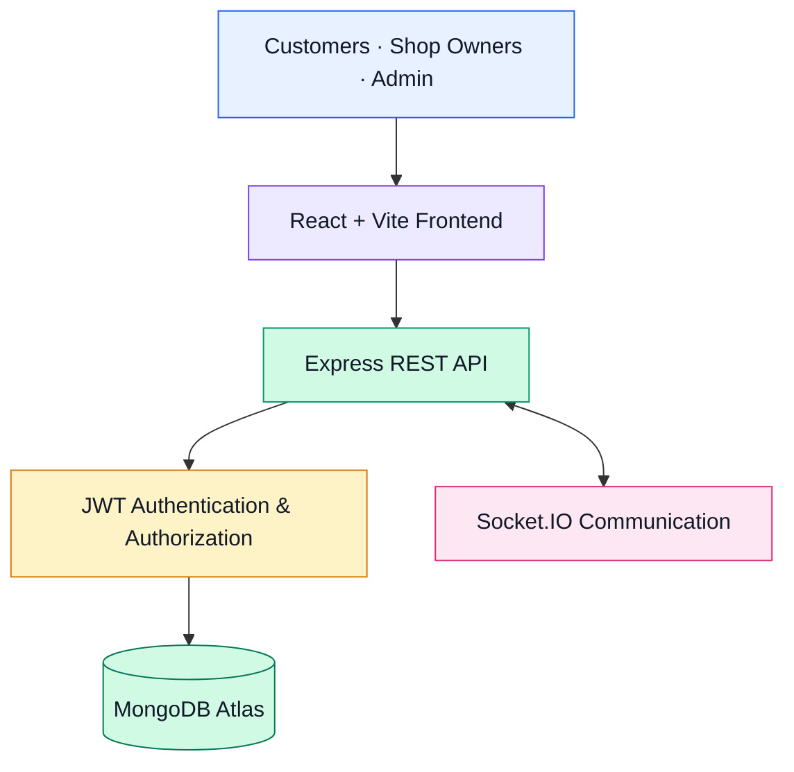

# 🛒 COERMart — Campus Food & Stationery Delivery Platform

<p align="center">
  <b>A full-stack campus marketplace connecting students, faculty, and campus shops.</b>
  <br />
  <a href="https://coer-mart-xi.vercel.app/"><strong>🚀 Live Demo</strong></a>
</p>

<p align="center">
  
  
  
  
  
  
</p>

## 🌐 Live Application

**Try COERMart:** [https://coer-mart-xi.vercel.app/](https://coer-mart-xi.vercel.app/)

COERMart is a full-stack web application designed to simplify food and stationery ordering within a university campus. It brings multiple campus shops into one digital platform, enabling users to browse products, place orders, and follow order progress while shop owners manage incoming orders.

## 🎯 Problem Statement

Students and faculty may need to visit multiple campus shops to purchase snacks, beverages, meals, and stationery. This can be inconvenient, particularly during busy college hours.

COERMart addresses this problem by providing a centralized campus marketplace that connects customers with campus shops through a single web application.

## ✨ Key Features

- **Campus Marketplace:** Browse food, beverages, snacks, and stationery from different campus shops.
- **Product Browsing:** View products available through the platform.
- **Shopping Cart & Checkout:** Add items to the cart and place orders.
- **Multi-Shop Ordering:** Handle items from different shops as separate shop orders.
- **Role-Based Access:** Separate experiences and permissions for customers, shop owners, and administrators.
- **Order Management:** Enable shop owners to handle incoming orders and update their progress.
- **Order Tracking:** Allow customers to check order status.
- **Admin Dashboard:** Support administration of campus shops and shop-owner accounts.
- **Cloud-Hosted Architecture:** Keep the frontend, backend, and database accessible independently of a local development machine.

## 🧰 Tech Stack

| Layer | Technologies |
|---|---|
| Frontend | React, Vite, TypeScript, Tailwind CSS |
| Backend | Node.js, Express.js |
| Database | MongoDB Atlas, MongoDB, Mongoose |
| Authentication | JSON Web Tokens (JWT), bcryptjs |
| Real-Time Communication | Socket.IO |
| API Communication | REST APIs, JSON |
| Frontend Deployment | Vercel |
| Backend Deployment | Render |
| Version Control | Git, GitHub |

## 🏗️ System Architecture



### Request Flow

1. A user interacts with the React frontend.
2. The frontend sends HTTP requests to the Express backend.
3. The backend validates requests and checks authentication and permissions where required.
4. Mongoose communicates with MongoDB Atlas to read or update application data.
5. The API returns the result to the frontend, which updates the interface.

## 🛍️ How It Works

### Customer Workflow
1. Browse campus shops and available products.
2. Add products to the shopping cart.
3. Proceed to checkout and place an order.
4. View orders and check their status.

### Shop Owner Workflow
1. Log in with a shop-owner account.
2. Access the relevant shop's information and orders.
3. Manage incoming orders and update order progress.

### Administrator Workflow
1. Access the admin dashboard.
2. View and manage shop-owner information and campus shops.
3. Oversee the platform through administrative functionality.

## 🔐 Authentication & Data Management

COERMart uses a backend API to manage application operations and MongoDB Atlas as its cloud database.

The application incorporates:
- JWT-based authentication for protected API access.
- Password hashing with bcryptjs.
- Role-based authorization for different user types.
- Mongoose models for structured access to MongoDB documents.
- Environment variables for deployment-specific configuration.

Security controls should be reviewed and tested before opening the application to a wider production audience.

## ☁️ Deployment

| Component | Platform |
|---|---|
| Frontend | [Vercel](https://vercel.com/) |
| Backend API | [Render](https://render.com/) |
| Cloud Database | [MongoDB Atlas](https://www.mongodb.com/atlas) |

The deployed frontend communicates with the hosted backend, which connects to MongoDB Atlas. This architecture allows the application to be accessed through a public website without requiring the developer's computer to remain online.

## 💻 Run Locally

### Prerequisites

- Node.js and npm
- Git
- MongoDB Atlas account or a local MongoDB instance

### 1. Clone the repository

```bash
git clone https://github.com/Love-hash-cell/COERMart.git
cd COERMart
```

### 2. Configure the backend

```bash
cd backend
npm install
```

Create a `.env` file inside the `backend` directory using your own environment values:

```env
PORT=5000
MONGO_URI=your_mongodb_connection_string
FRONTEND_URL=http://localhost:5173
JWT_SECRET=your_strong_random_secret
```

Use the exact variable names expected by your backend code. Never commit real database credentials, JWT secrets, or other private environment values.

Start the backend:

```bash
node server.js
```

### 3. Configure the frontend

Open a second terminal at the repository root:

```bash
npm install
```

Create or update the frontend environment file, typically `.env`, with:

```env
VITE_API_URL=http://localhost:5000
```

Start the development server:

```bash
npm run dev
```

Open the local URL displayed by Vite, usually `http://localhost:5173`.

> **Note:** These instructions assume the frontend `package.json` is in the repository root and the backend has its own `package.json`. Adjust the commands if your repository structure differs.

## 📁 Project Structure

```text
COERMart/
├── backend/
│   ├── config/
│   │   └── db.js
│   ├── middleware/
│   ├── models/
│   ├── routes/
│   ├── .env                  # Local only; never commit
│   ├── package.json
│   └── server.js
├── src/
│   ├── components/
│   ├── pages/
│   ├── context/
│   └── ...
├── public/
├── package.json
├── README.md
└── .gitignore
```

*The frontend folders shown above are illustrative; retain your repository's actual folder structure when documenting the project.*

## 🧠 Engineering Highlights

- Designed a multi-role full-stack application with a separate frontend, API backend, and cloud database.
- Implemented REST API integration between the frontend and backend.
- Worked with document-based data modeling using MongoDB and Mongoose.
- Integrated authentication and role-based access patterns.
- Developed order-management workflows for a multi-shop environment.
- Configured environment variables and deployed the application across Vercel, Render, and MongoDB Atlas.
- Troubleshot a production database configuration issue and verified that the backend connected to the intended `coermart` database.

## 🚀 Future Enhancements

- Online payments with server-side payment verification.
- Automated notifications for order updates.
- More comprehensive automated testing and API validation.
- Improved monitoring, backups, and recovery procedures.
- Performance optimization and load testing.
- Enhanced accessibility and mobile experience.

## 👨‍💻 Developer

**Love**  
B.Tech Computer Science & Engineering

Interested in full-stack development, AI-powered applications, and building software that solves practical problems.

- **Live Project:** [COERMart](https://coer-mart-xi.vercel.app/)
- **GitHub Repository:** [Love-hash-cell/COERMart](https://github.com/Love-hash-cell/COERMart)

---

<p align="center">
  <b>COERMart — Making campus shopping more convenient, one order at a time. 🛒</b>
</p>
